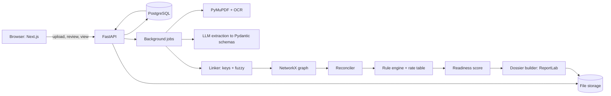

# ClaimGraph: Master Plan

> Team **Missing Piece** · Team leader: Harshit Garg · Event: Innovex (AI, Data Science & Automation)
> Repo: `InnovexClaimgraph` · Last updated: 14 Oct 2026

This file is the single source of truth for what we are building. If the code and this file disagree, fix one of them the same day. Anything not written here is **not** in scope until we add it here.

---

## 1. What we are building (one paragraph)

ClaimGraph is a **verifiable evidence compiler for MSME delayed-payment claims**. A small supplier uploads the messy records of one deal (PO, challan or delivery note, invoice, bank statement, emails). ClaimGraph extracts the facts, links them into one chain (PO → delivery → invoice → payment), checks them against each other, applies the MSMED Act rules in code, and produces a **claim-ready dossier** in which every number can be traced back to a page of a source document.

**Core promise:** the LLM only *reads*. Every verdict (mismatch, due date, interest, readiness) comes from deterministic code that anyone can re-run and verify. It is evidence, not a chatbot answer.

**Who it is for:** MSME owners, their accountants and legal advisers.
**What it is not:** legal advice, an auto-filing bot, or a chatbot.

---

## 2. What changed since the submitted PPT (we build the current version)

The PPT is submitted and stays as is. The build follows the facts below, and we explain the differences in the pitch.

| Topic | PPT says | We build / say |
|---|---|---|
| Filing portal | Samadhaan / ODR | **MSME ODR portal**. New cases go only there since 15 Oct 2025. Dossier mirrors its invoice-by-invoice fields. |
| Due date | 45 days from acceptance | 45 days max **plus** deemed acceptance (no written objection within 15 days of delivery) and 15-day default if no written credit period. One clock per invoice. |
| Interest | 3x RBI bank rate | Same, but with a **dated rate table** (Bank Rate moved to 5.75% on 7 Oct 2026) and slice-wise calculation. |
| Who can claim | not covered | **Eligibility gate**: micro or small, Udyam registered **before** the contract date, not a pure trader. |
| Law status | fixed | MSMED (Amendment) Act 2026 is passed but not yet in force. Rules live in **versioned config**, not in code. |
| Output | PDF dossier | PDF dossier **plus** draft written demand notice **plus** ODR-ready invoice sheet. |
| Completeness | a number | A **visible formula** (section 7.4). |
| Market number | ₹8.1 lakh crore | In the pitch say "₹7 to ₹10 lakh crore depending on the report" (₹7.34 lakh crore, Mar 2024, GAME/FISME/C2FO). |

Legal items are implemented as we understand them. Items marked **[VERIFY]** must be checked with a CA or lawyer before we state them as fact on stage.

---

## 3. Locked scope

### 3.1 MVP: must work in the live demo (P0)

1. **Case workspace**: create a case (supplier and buyer), upload documents, see processing status.
2. **Ingestion**: PDF and image upload, document type detection, text via PDF text layer or OCR, extraction into strict Pydantic schemas. Each extracted field keeps `doc_id`, `page`, `bbox`, `confidence`.
3. **Review screen**: the user confirms or edits low-confidence fields. Nothing unconfirmed feeds a verdict.
4. **Linking**: PO ↔ delivery ↔ invoice ↔ payment using hard keys first, fuzzy match second, human confirm third.
5. **Reconciliation ledger**: ordered vs delivered vs billed vs paid, per line and per invoice, including adjustments (TDS, debit notes, short-payment).
6. **Findings**: quantity gap, price gap, duplicate invoice, uncredited partial payment, unmatched payment, missing document, date conflict.
7. **Rule engine**: eligibility, deemed acceptance, due date, days overdue, interest by rate slice, limitation flag.
8. **Graph view**: nodes coloured by state (verified, attention, conflict), click a node to open its source.
9. **Evidence drawer**: click any number anywhere, the source page opens with the field highlighted.
10. **Dossier export**: PDF with timeline, ledger, findings, missing-document checklist, interest working, readiness score, hash manifest.
11. **What-if demo moment**: add the backorder email, the affected node and ledger line recompute live, score updates.

### 3.2 Advanced (P1): build after MVP is stable

- **Draft demand notice** (template filled by code; no LLM-written legal text).
- **ODR-ready sheet**: invoice-by-invoice CSV/XLSX matching the portal's fields (invoice no., date, amount, acceptance date, part payments).
- **Email intelligence**: classify emails as acceptance, objection, backorder, promise-to-pay, acknowledgment of debt, with the quote and message date linked.
- **Objection window tracker**: shows whether the 15-day written-objection window passed.
- **Dossier tamper evidence**: SHA-256 of every source file, extraction version, rule-pack version, timestamp, printed in the dossier.
- **Interest timeline chart**: principal and accrued interest over time with the rate changes marked.
- **Reviewer audit log**: who confirmed or changed which field, and when.

### 3.3 Wow factor (P2): only if time remains

- **Portfolio view**: all buyers who owe the supplier, total principal, interest, oldest overdue.
- **Buyer-side leverage note**: summary of the Income Tax Sec. 43B(h) angle for the buyer **[VERIFY]**.
- **Hindi and bilingual OCR** for challans and handwritten notes.
- **Settlement calculator**: "if the buyer pays X on date Y, what remains".

### 3.4 Future scope (pitch slide only, not built)

- Tally, Zoho Books, Vyapar import.
- Guided filing on the ODR portal (we found no public API; do not promise it).
- GST e-invoice / e-way bill cross-check.
- WhatsApp document intake.
- Buyer payment-behaviour scoring and early-warning alerts.
- Multi-user workspaces for accountant and legal adviser with roles.
- On-premise or private-model option for sensitive data.
- Support for other dispute routes (arbitration clauses, civil recovery).

### 3.5 Explicitly out of scope

Legal advice, automatic filing, payments, model training or fine-tuning, user accounts and billing, mobile app, any claim on behalf of ineligible suppliers.

---

## 4. Architecture



### 4.1 Pipeline stages (each stage is a pure function with tests)

| # | Stage | Input | Output | Uses LLM? |
|---|---|---|---|---|
| 1 | Store | uploaded file | file + SHA-256 + page images | no |
| 2 | Read | file | page text + word boxes (PDF text layer, else OCR) | no |
| 3 | Classify | page text | doc type: PO, challan, invoice, bank, email, other | yes (constrained label) |
| 4 | Extract | page text + doc type | schema-valid facts with page and box | yes (constrained JSON) |
| 5 | Validate | facts | normalised numbers, dates, GSTIN format, totals checks | no |
| 6 | Review | low-confidence facts | confirmed facts | human |
| 7 | Link | confirmed facts | edges between documents | fuzzy assist only, human confirm |
| 8 | Reconcile | linked chain | ledger lines + findings | no |
| 9 | Rules | ledger + dates + rate table | eligibility, due dates, interest, flags | no |
| 10 | Score | findings + checklist | readiness score and blockers | no |
| 11 | Export | everything | PDF, notice, ODR sheet | no |

**Rule:** stages 5 to 11 never call an LLM. If an LLM result and a deterministic result differ, the deterministic one wins and the difference is shown to the user.

### 4.2 Environments

| Env | Where | Notes |
|---|---|---|
| Local dev | Docker Compose: Postgres + backend + frontend | Everyone runs the same stack. Seed data makes demos reproducible. |
| Demo | Frontend on Vercel, backend on Render or Railway, Postgres + storage on Supabase | Set up in the last milestone. Keep a **local fallback** in case venue Wi-Fi fails. |

---

## 5. Tech stack (locked)

### Frontend
- **Next.js (App Router), React, TypeScript**
- **Tailwind CSS** with design tokens from section 8, and **shadcn/ui** primitives restyled to our tokens
- **React Flow (`@xyflow/react`)** for the graph
- **react-pdf (pdf.js)** for the evidence drawer with box highlights
- **TanStack Query** for server state, **Zustand** for small UI state
- **lucide-react** for icons
- **openapi-typescript** to generate API types from the backend (no hand-written API types)

### Backend
- **Python 3.11+, FastAPI, Pydantic v2**
- **SQLAlchemy 2 + Alembic** for models and migrations
- **PyMuPDF** for PDF text, page images and boxes
- **PaddleOCR or Tesseract** for scans (pick one in M3 after testing on our messy sample; keep behind one `OcrEngine` interface)
- **rapidfuzz** for fuzzy matching of item names and references
- **NetworkX** for the transaction graph
- **ReportLab** for the PDF dossier (pure Python, installs cleanly on Windows)
- **openpyxl** for the ODR-ready sheet
- **pytest** with golden tests for rules and reconciliation

### LLM
- Provider-agnostic wrapper `llm/client.py`, model names read from env (`LLM_EXTRACT_MODEL`, `LLM_CLASSIFY_MODEL`). Check current model names in the provider docs when we wire it.
- Always **schema-constrained output** (tool/JSON schema) then Pydantic validation, one retry on failure, then mark the field "needs review".
- Cache by file hash plus prompt version so demos are fast and repeatable.

### Data and infra
- **PostgreSQL** (JSONB for raw extraction payloads)
- **File storage** behind a `Storage` interface: local disk in dev, Supabase Storage in demo
- **Background jobs**: FastAPI `BackgroundTasks` + a `jobs` table with status. No Redis until we actually need it.

### Removed from the PPT stack
- **pgvector**: nothing in our design needs semantic search.
- **Redis**: not needed for the MVP.
- **Auth**: single demo workspace for now.

---

## 6. Data model (core tables)

```
cases            id, title, supplier_id, buyer_id, status, created_at
parties          id, name, role(supplier|buyer), gstin, pan, udyam_no, udyam_reg_date,
                 enterprise_type(micro|small|medium), activity(manufacturer|service|trader)
documents        id, case_id, kind, filename, sha256, storage_path, pages, uploaded_at
pages            id, document_id, page_no, text, image_path, ocr_engine
facts            id, case_id, document_id, page_no, field, value_json, bbox, confidence,
                 status(auto|needs_review|confirmed|edited), extractor_version, confirmed_by, confirmed_at
purchase_orders  id, case_id, po_no, po_date, credit_days_written, terms_fact_id
po_lines         id, po_id, item_key, description, qty, unit, rate
deliveries       id, case_id, challan_no, delivery_date, received_by, acceptance_fact_id
delivery_lines   id, delivery_id, item_key, qty
invoices         id, case_id, invoice_no, invoice_date, gstin_s, gstin_b, taxable, gst, total
invoice_lines    id, invoice_id, item_key, qty, rate, amount
payments         id, case_id, utr, pay_date, amount, bank_ref_text, fact_id
adjustments      id, case_id, kind(tds|debit_note|credit_note|short_payment|other), amount, ref
communications   id, case_id, doc_id, msg_date, sender, kind(acceptance|objection|backorder|
                 promise_to_pay|acknowledgment|other), quote, fact_id
links            id, case_id, from_type, from_id, to_type, to_id, method(key|fuzzy|manual), confidence, confirmed
findings         id, case_id, code, severity(info|warn|blocker), message, refs_json, resolved_by_fact_id
rate_table       id, effective_from, bank_rate_pct, source_note
rule_packs       id, name, version, effective_from, config_json
rule_runs        id, case_id, rule_pack_id, result_json, run_at
dossiers         id, case_id, version, storage_path, manifest_json, created_at
audit_log        id, case_id, actor, action, target, before_json, after_json, at
jobs             id, case_id, kind, status, error, started_at, finished_at
```

**Provenance rule:** any number shown in the UI or the PDF must be reachable through a `fact_id` to `(document, page, bbox)`. If it cannot, it is not shown as a fact.

---

## 7. Rules engine specification

All rules are pure functions: `(case snapshot, rule pack, rate table) -> result`. Same input gives the same output, always.

### 7.1 Eligibility gate (blocks the "ready" state)

- Supplier is **micro or small** (medium and large are not covered) **[VERIFY exact wording]**.
- **Udyam registration date is on or before the contract/PO date** (court rulings treat this as required) **[VERIFY: a larger-bench reference is pending]**.
- Supplier is not purely a trader **[VERIFY]**.
- Written PO or contract exists.
- Output: `eligible | not_eligible | unknown`, each with the reason and the fact it came from.

### 7.2 Acceptance and due date (per invoice, per delivery)

1. `acceptance_date` = date of written acceptance in a challan stamp or email, **else** `delivery_date + 15 days` if there is no written objection (deemed acceptance). The basis is stored: `actual` or `deemed`.
2. `credit_days` = written agreed period if present and at most 45, else 15 if none is agreed in writing. A written period above 45 is capped at 45 and flagged.
3. `due_date = acceptance_date + credit_days`. The exact day-count convention is in the rule pack **[VERIFY]**.
4. Partial deliveries: each delivery has its own acceptance and clock. An invoice covering goods not yet delivered is flagged, and the claimable principal is limited to delivered and accepted value.

### 7.3 Interest

- Annual rate = **3 x Bank Rate** in force, from the dated `rate_table`.
- Compounded with **monthly rests**.
- Interest runs on unpaid principal from the day after `due_date`. Payments reduce principal from their date.
- When the Bank Rate changes mid-claim, compute in **slices** by rate period. Which rate applies across a change is a legal choice kept as a rule-pack option **[VERIFY]**.
- Partial-month convention is a rule-pack option, default documented in the dossier.

**Seed rate table** (confirm each row against RBI before demo):

| effective_from | bank_rate_pct |
|---|---|
| 2026-10-07 | 5.75 |
| before that | 5.50 |

**Golden test (hand-checkable):** principal ₹1,00,000, 3 full months overdue at a Bank Rate of 5.75%. Annual rate 17.25%, monthly 1.4375%. Amount = 1,00,000 x (1.014375)^3 = ₹1,04,374.79, interest ₹4,374.79. Add more golden cases (partial payment, rate change) and have a CA confirm them.

### 7.4 Readiness score (visible formula)

Per invoice, 100 points:

| Check | Points |
|---|---|
| PO found and linked | 15 |
| Written credit terms evidenced | 10 |
| Delivery proof linked, quantities match | 20 |
| Acceptance evidence, or deemed-acceptance basis documented | 15 |
| Invoice fields valid and not a duplicate | 10 |
| Payments and adjustments reconciled to the paisa | 15 |
| No open blocker findings | 15 |

Case score = principal-weighted average of invoice scores. **Case gates** (hard stops, shown as blockers, not points): eligibility not failed, Udyam certificate present, all low-confidence facts reviewed.

### 7.5 Limitation flag

Flag invoices where due date is older than the limitation window for arbitration **[VERIFY period and effect of acknowledgments]**. Show as a warning, never as a verdict.

### 7.6 Findings catalogue

`QTY_MISMATCH`, `PRICE_MISMATCH`, `DUPLICATE_INVOICE`, `UNCREDITED_PAYMENT`, `UNMATCHED_PAYMENT`, `TDS_DEDUCTION`, `MISSING_PO`, `MISSING_DELIVERY_PROOF`, `MISSING_ACCEPTANCE`, `DATE_CONFLICT`, `GST_MISMATCH`, `UDYAM_MISSING`, `INELIGIBLE_SUPPLIER`, `TIME_BARRED_RISK`, `BACKORDER_PENDING`.

Each finding has a plain-language message, severity, the facts involved, and what the user can upload or do to resolve it.

---

## 8. Frontend design

### 8.1 Direction

ClaimGraph should feel like a **careful audit workpaper**, not a startup landing page. The user is anxious about money they are owed, so the design must feel calm, precise and trustworthy. The memorable element is the **evidence trail**: click any number and the exact place in the source document lights up.

**Hard rules**
- **No purple, indigo or violet. No gradient washes. No glassmorphism. No glowing effects.**
- No emoji as icons. No identical rounded-card grids for everything.
- No tracked-out all-caps labels above every heading.
- Flat surfaces, thin rules, one border radius family used with intent.
- Light theme only for the MVP.

### 8.2 Tokens

**Colour** (continuity with the deck's green, kept restrained)

| Token | Hex | Use |
|---|---|---|
| `ink` | `#16282B` | primary text, primary buttons |
| `paper` | `#F6F7F4` | page background |
| `surface` | `#FFFFFF` | panels, tables |
| `rule` | `#D9DDD6` | lines and borders |
| `slate` | `#5B6B73` | secondary text |
| `verified` | `#1E6B57` | verified, matched, confirmed |
| `attention` | `#B7791F` | needs review, warning |
| `conflict` | `#B83A2E` | mismatch, blocker |
| `link` | `#2F5D8A` | links, graph edges, selection |

Status colours always come with an icon or text label, never colour alone.

**Type**
- Headings: **Source Serif 4** (600)
- UI and body: **Public Sans** (400, 500, 600)
- Numbers in tables: Public Sans with `font-variant-numeric: tabular-nums`
- Hashes, UTRs, IDs only: **JetBrains Mono**
- Scale: 13 / 14 / 16 / 20 / 28 / 40. Body line length under 75 characters.

**Numbers and dates:** Indian grouping (`₹1,04,374.79`, `Intl.NumberFormat('en-IN')`), dates as `14 Oct 2026`.

**Radius:** 4px for controls and table cells, 8px for panels. **Spacing:** 4px base grid.

### 8.3 Screens

1. **Cases**: a plain table of cases (supplier, buyer, principal owed, interest accrued, readiness, last activity). No card grid.
2. **Case workspace**: three-pane layout.
3. **New case / upload**: drag-drop zone with per-file status (stored, read, extracted, needs review).
4. **Dossier preview**: the PDF in-page with a download button and the hash manifest.

**Workspace wireframe**

```
+-------------------+----------------------------------------------+------------------------+
| Documents         |  Tabs: Graph | Ledger | Interest | Findings   |  Evidence              |
|                   |                                              |                        |
| PO-2291.pdf    ok |   [PO 500] -> [Delivery 460] -> [Invoice 500]|  Challan 118, page 1   |
| CH-118.jpg     !  |                   (conflict)      -> [Pay]   |  +------------------+  |
| INV-7731.pdf   ok |                                              |  |  qty  [460]      |  |
| bank-sep.pdf   ok |  Ready to file: 72%   Blockers: 2            |  +------------------+  |
| mail-thread    ok |  Principal owed ₹4,12,000   Interest ₹9,430  |  Extracted by v1.3     |
| [+ Add document]  |                                              |  Confirmed by Harshit  |
+-------------------+----------------------------------------------+------------------------+
```

- **Left:** documents with status.
- **Centre:** the main view. A summary strip above it always shows principal, interest, readiness and number of blockers.
- **Right:** evidence drawer. Opens on any click of a node, ledger cell or finding.
- On mobile the drawer becomes a bottom sheet and the left pane becomes a drawer.

### 8.4 Graph view

- Nodes: PO, delivery, invoice, payment, communication. Fixed left-to-right flow, no force-directed chaos.
- Node shows type, number, date and the key quantity or amount.
- Border and icon encode state (verified, attention, conflict). Edges are solid when confirmed, dashed when proposed.
- Clicking a node opens evidence. Clicking a conflict opens the finding with "what to upload".

### 8.5 Ledger view

A real table, not cards: one row per item line, columns Ordered, Delivered, Billed, Paid, Difference. Differences coloured and labelled. Totals row sticky. Every cell opens evidence.

### 8.6 Motion

Motion only answers an action. **One** deliberate moment: in the what-if step, when the backorder email is added, the red node settles to its new state, the edge draws, and the readiness number counts to its new value. Respect `prefers-reduced-motion`. No entrance animations on sections or card hover effects.

### 8.7 Copy

Plain, direct, sentence case. "Delivered 460 of 500 units", not "Quantity discrepancy detected". Buttons are verbs ("Confirm field", "Add document", "Download dossier"). Errors say what happened and what to do. Never promise legal outcomes.

### 8.8 Quality floor

Responsive to mobile, visible keyboard focus, AA contrast, labelled icon buttons, loading and empty states for every screen, no layout shift on status changes.

---

## 9. API surface (v1)

```
POST   /cases                         create case
GET    /cases                         list
GET    /cases/{id}                    summary (principal, interest, score, blockers)
POST   /cases/{id}/documents          upload file(s)
GET    /cases/{id}/documents          list with status
GET    /documents/{id}/pages/{n}      page image + word boxes
GET    /cases/{id}/facts?status=      facts to review
PATCH  /facts/{id}                    confirm or edit
POST   /cases/{id}/links/{id}/confirm confirm proposed link
GET    /cases/{id}/graph              nodes + edges for React Flow
GET    /cases/{id}/ledger             lines + adjustments + totals
GET    /cases/{id}/findings           open and resolved
GET    /cases/{id}/rules              eligibility, due dates, interest working
POST   /cases/{id}/recompute          rerun linking, reconcile, rules, score
POST   /cases/{id}/dossier            build PDF (+ notice, ODR sheet)
GET    /rate-table                    current rates
GET    /jobs/{id}                     job status
```

**Contract first:** backend publishes OpenAPI, frontend generates types from it. Change an endpoint, regenerate types, commit both.

---

## 10. Repository layout

```
InnovexClaimgraph/
  README.md
  CLAIMGRAPH_MASTER_PLAN.md       <- this file
  docker-compose.yml
  .env.example
  backend/
    app/
      main.py
      api/                        routers only, no logic
      core/                       config, db, storage
      models/                     SQLAlchemy models
      schemas/                    Pydantic schemas (extraction + API)
      ingest/                     read, ocr, classify, extract, validate
      llm/                        client wrapper, prompts (versioned)
      link/                       key match, fuzzy match, graph build
      reconcile/                  ledger + findings
      rules/                      eligibility, due date, interest, score
      rules/packs/                versioned rule-pack JSON + rate_table seed
      dossier/                    PDF, notice, ODR sheet
      jobs/                       background job runners
    alembic/
    tests/                        unit + golden tests
  frontend/
    app/                          routes
    components/                   ui, graph, ledger, evidence
    lib/                          api client, formatters (en-IN), tokens
    styles/
  data/
    synthetic/                    demo cases (documents + expected outputs)
  docs/
    demo-script.md
    legal-checklist.md            every [VERIFY] item and its status
```

---

## 11. Synthetic demo data (build first, everything depends on it)

All names are fictional. Each case folder holds the documents plus `expected.json` (ledger, findings, due dates, interest) used by tests.

| Case | Story | Tests |
|---|---|---|
| A: main demo | Supplier ships 460 of 500; invoices 500; partial payment with TDS deducted; later backorder email for 40 | mismatch, TDS adjustment, what-if recompute |
| B: duplicates | Same invoice re-sent with a new date; advance payment not credited | duplicate and uncredited payment findings |
| C: ineligible | Udyam registered after the PO date (or medium enterprise) | engine refuses to mark ready and explains why |
| D: messy scan | Phone photo of a challan, skewed, stamped | OCR path, review screen |

**Demo question to settle in the team:** in case A, is the 40-unit backorder *delivered* or only *promised*? If only promised, the claimable principal stays at 460 units and the 40 show as `BACKORDER_PENDING`, not green. Decide before building the what-if step.

---

## 12. Build plan (one prompt, one milestone)

Each milestone ends with: tests passing, app runs via `docker compose up`, a short note added to the README, one clean commit.

| # | Milestone | Done when |
|---|---|---|
| M0 | Repo scaffold | Monorepo, Docker Compose (Postgres, backend, frontend), lint, `.env.example`, health-check page |
| M1 | Data model and synthetic data | Migrations run, seed loads, cases A to D present with `expected.json` |
| M2 | Rule engine | Eligibility, due date, interest, score with golden tests all green (no UI yet) |
| M3 | Ingestion | Upload, read, classify, extract to schemas with page and box, stored as facts |
| M4 | Review screen | Low-confidence facts listed, confirm and edit work, audit log written |
| M5 | Link, graph, reconcile | Graph API and findings correct on cases A to C |
| M6 | Workspace UI | Three-pane layout, graph, ledger, evidence drawer with highlights |
| M7 | Dossier | PDF, demand notice, ODR sheet, hash manifest |
| M8 | What-if, polish, deploy | Demo flow runs end to end, deployed, local fallback ready, demo script rehearsed |

**P1 and P2 features slot in after M8 or in parallel if the team is large enough.**

---

## 13. Working agreements (avoid clashes)

- **Branches:** `main` is always demo-ready. Work on `feat/<milestone>-<short-name>`, merge by pull request, at least one review.
- **Commits:** `type(scope): message`, for example `feat(rules): add interest slices`.
- **Ownership:** each folder in section 10 has one owner at a time. Cross-folder changes go through the API contract.
- **Contract first:** schema or endpoint changes are merged before the code that uses them.
- **Rules live in data:** no hard-coded rates, day counts or thresholds in code.
- **No secrets in git:** `.env` is ignored, `.env.example` is committed.
- **Legal items:** every `[VERIFY]` goes into `docs/legal-checklist.md` with an owner and a status.
- **Prompts:** LLM prompts are versioned files under `llm/`, and the version is stored with each fact.

---

## 14. Demo script (3 to 4 minutes)

1. **Problem (20 s):** a supplier's proof is scattered, so claims stall.
2. **Upload (30 s):** drop case A's messy records. Statuses tick through.
3. **Review (20 s):** confirm two low-confidence fields.
4. **The clash (40 s):** the graph shows 500 / 460 / 500 with the conflict in red. The ledger shows the undisputed amount. Click the number and the challan page lights up.
5. **Rules (30 s):** due date, deemed acceptance, interest at today's rate, with the 7 Oct rate change visible in the table.
6. **What-if (40 s):** add the backorder email. Node, ledger and score update live.
7. **Dossier (30 s):** download the PDF, show the hash manifest and the demand notice.
8. **Close (20 s):** "The LLM reads. The rules decide. Every number traces to a page."

**Likely judge questions, prepared answers**
- *Where does the market number come from?* Reports range ₹7 to ₹10 lakh crore; cite GAME/FISME/C2FO.
- *What if the law changes?* Rules and rates are versioned data; we update a pack.
- *Is this legal advice?* No. It prepares evidence; a human reviews every line.
- *What about OCR or LLM errors?* Strict schemas, confidence flags, mandatory review, deterministic verdicts.
- *Data privacy?* Documents stay in the case workspace; private-model option on the roadmap.

---

## 15. Risks and mitigations

| Risk | Mitigation |
|---|---|
| OCR fails on messy scans | Review screen, test on case D early, keep two OCR engines behind one interface |
| LLM extracts wrong values | Schema-constrained output, validation, confidence flags, human confirm |
| Legal rules misstated | `[VERIFY]` list, CA or lawyer review, "not legal advice" notice, rules as data |
| Demo breaks on stage | Cached extraction for demo files, local fallback, rehearsed script |
| Scope creep | This file is the scope. New ideas go to section 3.3 or 3.4 first. |
| Team collisions | Folder owners, contract-first API, small PRs |

---

## 16. Open decisions (confirm in the team chat)

1. Operating system on team laptops (Windows affects OCR and PDF library choices).
2. LLM provider and API key owner, and a monthly spend cap.
3. Who is the owner for each folder in section 10.
4. Who can get a CA or lawyer to review the `[VERIFY]` items this week.
5. Hackathon dates and the pitch slot length, to trim P1 if needed.
6. Backorder question in section 11.

---

## 17. Sources checked (14 Oct 2026)

- MSME ODR portal launch and mandatory filing from 15 Oct 2025: YourStory, "How the MSME ODR portal is helping small businesses recover delayed payments".
- Sections 15 to 18, deemed acceptance, Udyam timing, pending references, 2026 amendment status: iPleaders, "MSME Samadhaan: Recovering A Delayed Payment".
- Bank Rate and policy rates: RBI website, current rates page, and news on the 7 Oct 2026 MPC decision.
- Delayed payment size: GAME/FISME/C2FO report (₹7.34 lakh crore, Mar 2024) and earlier GAME/D&B estimates.

Re-check every legal and rate item against primary sources (India Code, RBI, MSME ministry) before the pitch.
